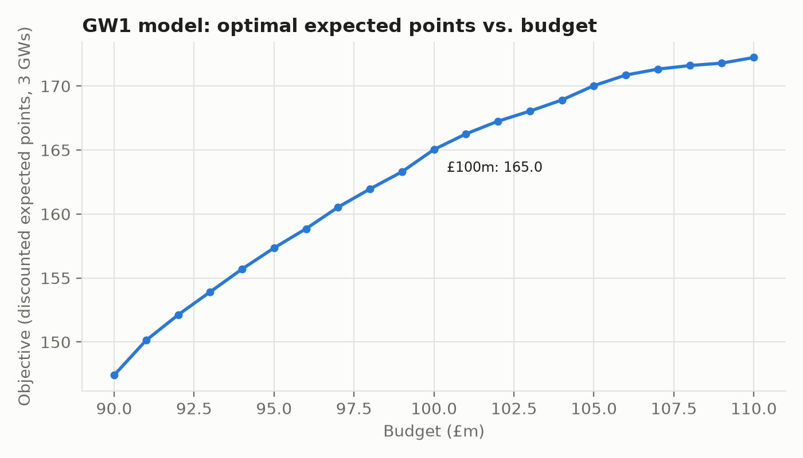

# Fantasy Premier League Season Optimization with MILP

**ISE 3230, Group 5**: Jiho Choi, Suleiman Bainazarov, Ari Palmer

A multi-period mixed-integer linear program (MILP), solved with Gurobi, that plays the full
**2025-26 Fantasy Premier League (FPL)** season week by week and scores every decision with the
**real** points.

---

## 1. Introduction and Motivation

**FPL.** Fantasy Premier League is the official fantasy game of the English Premier League. More than
13 million teams took part in 2025-26, and top managers win prizes such as a seven-night trip to the UK.
Each manager has a **£100m budget** for a **15-player squad** (2 GK, 5 DEF, 5 MID, 3 FWD, at most 3
players from one club). Before each of the 38 gameweeks (GWs) the manager decides:

- which **11 players start**, in a valid formation
- who is **captain** (his points count double)
- which players to **buy and sell**. Each GW gives 1 free transfer (unused ones roll over, up to 5);
  every extra transfer (a "hit") costs **4 points**.

**Problem.** Maximize total points over the season. The decisions must be made **before** the
matches are played, so the real points are unknown when deciding.

**Approach: rolling horizon.** At the deadline of every GW *t*:

1. forecast the expected points of every player for GWs *t … t+H−1*, using only data up to GW *t−1*
2. solve the MILP for those *H* weeks
3. carry out **only the GW-*t*** decisions (squad, starting XI, captain, transfers)
4. score them with the **real** GW-*t* points, then move to GW *t+1*

The main model plans **H = 3** weeks ahead. As in our proposal, we compare its real season points with
simpler strategies and analyze how the result changes with the look-ahead and the budget.

**Main results.** The main model scores **1,968 points**, well above never transferring (1,459) and
planning only one week ahead (1,913), and 32 points below following the most-owned players (2,000).

---

## 2. Decision Variables

For every candidate player *p* and every planned gameweek *g* (*t* is the current GW):

| Variable | Type | Meaning |
|---|---|---|
| $`x_{p,g}`$ | binary | 1 if player *p* is in the 15-man squad in GW *g* |
| $`y_{p,g}`$ | binary | 1 if *p* is in the starting XI |
| $`c_{p,g}`$ | binary | 1 if *p* is captain |
| $`b_{p,g}`$ | binary | 1 if *p* is bought before GW *g* |
| $`s_{p,g}`$ | binary | 1 if *p* is sold before GW *g* |
| $`ft_g`$ | integer, 0–5 | free transfers available in GW *g* |
| $`u_g`$ | integer ≥ 0 | free transfers used in GW *g* |
| $`h_g`$ | integer ≥ 0 | paid transfers ("hits") in GW *g* |
| $`bank_g`$ | continuous ≥ 0 | money left after the GW-*g* transfers (£m) |
| $`z_g`$ | binary | 1 if any transfer is made in GW *g*. Only needed when a real-life transfer leaves more than 3 of our players at one club (constraint 12) |

The vice-captain and the bench order are not variables: after solving, the vice-captain is the starter
with the second-highest expected points, and the bench is ordered GK first, then by expected points.

---

## 3. Formulation (`model.py`)

### 3.1 Sets and parameters

| Symbol | Meaning |
|---|---|
| $`P`$ | candidate players: all players in the game at GW *t* (690 at GW1, up to 841 later) |
| $`G = \{t, \dots, t+H-1\}`$ | planned gameweeks |
| $`P_k`$, $`k \in`$ {GK, DEF, MID, FWD} | players of position *k* |
| $`P_c`$ | players of club *c* |
| $`xP_{p,g}`$ | expected points of *p* in GW *g* (Section 3.2) |
| $`cost_p`$ | price of *p* at GW *t* (£m) |
| $`sell_p`$ | selling price of an owned player: purchase price + half of any price rise, rounded down to £0.1m (FPL rule). Equal to $`cost_p`$ for players we don't own |
| $`q_k`$ | squad quota: 2, 5, 5, 3 |
| $`L_k, \; U_k`$ | formation limits in the XI: GK 1–1, DEF 3–5, MID 2–5, FWD 1–3 |
| $`S_0, \; B_0, \; F_0`$ | state at the deadline of GW *t*: current squad, bank, free transfers |
| $`e_c`$ | number of our players at club *c* above 3 (only > 0 after a real-life transfer) |
| $`\delta = 0.9, \; \beta = 0.1, \; \kappa = 4`$ | weekly discount, bench weight, hit cost |

The previous-week values for the first planned week come from the state:
$`x_{p,t-1} = 1`$ if $`p \in S_0`$ (else 0) and $`bank_{t-1} = B_0`$.

### 3.2 Where the expected points $`xP`$ come from

**Data.** Real 2025-26 season data from [vaastav/Fantasy-Premier-League](https://github.com/vaastav/Fantasy-Premier-League)
(points, prices, minutes, clubs and fixtures of 841 players over 38 GWs), plus last season (2024-25)
totals for the start of the season. No synthetic data. `data_prep.py` cleans it into one row per player
and GW; in double GWs (two matches) the points are summed, and in blank GWs (no match) they are 0.

**Forecast** (`forecast.py`). At the deadline of GW *t*, using only GWs 1 … *t*−1:

```math
xP_{p,g} \;=\; P(\text{play})_{p} \times \text{PPA}_{p} \times n_{\text{club}(p),\,g}
```

- $`P(\text{play})`$: share of his club's matches in the last 4 GWs that he played in, with recent GWs
  weighted more
- PPA: points per match played over the last 6 GWs
- $`n`$: number of matches his club plays in GW *g* (0, 1 or 2)
- Early in the season there is little data, so both values are mixed with last season's numbers.
  Players with no Premier League history get a value estimated from their price.

The 1-week-ahead forecast has a correlation of **0.55** with the real points.

### 3.3 Objective

```math
\max \; \sum_{g \in G} \delta^{\,g-t} \Big[ \sum_{p \in P} xP_{p,g}\,(y_{p,g} + c_{p,g})
\;+\; \beta \sum_{p \in P} xP_{p,g}\,(x_{p,g} - y_{p,g}) \;-\; \kappa\, h_g \Big]
```

- $`xP\,(y + c)`$: points of the starting XI; the captain is counted once more, so he scores double
- $`\beta\,xP\,(x - y)`$: a small value for bench players, who come on when a starter doesn't play
- $`\kappa\,h`$: 4 points for every hit
- $`\delta^{g-t}`$: later weeks count slightly less, because their forecasts are less reliable

### 3.4 Constraints

For every $`g \in G`$ and $`p \in P`$:

```math
x_{p,g} = x_{p,g-1} + b_{p,g} - s_{p,g} \qquad (1)
```

```math
s_{p,g} \le x_{p,g-1}, \qquad b_{p,g} \le 1 - x_{p,g-1} \qquad (2)
```

```math
bank_g = bank_{g-1} + \sum_{p} sell_p\, s_{p,g} - \sum_{p} cost_p\, b_{p,g}, \qquad bank_g \ge 0 \qquad (3)
```

```math
\sum_{p} x_{p,g} = 15, \qquad \sum_{p \in P_k} x_{p,g} = q_k \quad \forall k \qquad (4)
```

```math
\sum_{p \in P_c} x_{p,g} \le 3 \quad \forall c \text{ with } e_c \le 0 \qquad (5)
```

```math
y_{p,g} \le x_{p,g}, \qquad \sum_{p} y_{p,g} = 11 \qquad (6)
```

```math
L_k \le \sum_{p \in P_k} y_{p,g} \le U_k \quad \forall k \qquad (7)
```

```math
c_{p,g} \le y_{p,g}, \qquad \sum_{p} c_{p,g} = 1 \qquad (8)
```

```math
\sum_{p} b_{p,g} = u_g + h_g \qquad (9)
```

```math
u_g \le ft_g \qquad (10)
```

```math
ft_t = F_0, \qquad ft_g \le ft_{g-1} - u_{g-1} + 1 \;\; (g > t), \qquad 0 \le ft_g \le 5 \qquad (11)
```

```math
\sum_{p \in P_c} x_{p,g} \le 3 + e_c\,(1 - z_g) \quad \forall c \text{ with } e_c > 0, \qquad \sum_{p} b_{p,g} \le 15\, z_g \qquad (12)
```

| # | Meaning |
|---|---|
| (1) | squad flow: this week's squad = last week's + bought − sold |
| (2) | only an owned player can be sold, only a new player can be bought |
| (3) | budget: money changes only through transfers and can't be negative |
| (4) | 15 players: 2 GK, 5 DEF, 5 MID, 3 FWD |
| (5) | at most 3 players from one club |
| (6) | 11 starters, all from the squad |
| (7) | valid formation: exactly 1 GK, at least 3 DEF, 2 MID, 1 FWD |
| (8) | one captain, who must start |
| (9)–(10) | transfers are free up to $`ft_g`$, the rest are hits |
| (11) | unused free transfers roll over (+1 per week, max 5). FPL gave every manager 5 free transfers in GW16 of 2025-26, so $`ft_{16} = 5`$ |
| (12) | FPL rule: if a real-life transfer leaves us with 4 players from one club we may keep them, but any transfer we make must bring that club back to 3. $`z_g`$ switches the looser limit off once a transfer is made |

**GW1.** The squad is picked from scratch: $`S_0 = \emptyset`$, $`B_0 = 100`$. In GW1 constraints (9)–(11)
do not apply; instead $`u = h = ft = 0`$ and nothing is sold, so the 15 "bought" players are the
initial squad. GW2 then starts with 1 free transfer.

**Remarks.**

- In (11) the real rule is an equality. "≤" gives the same optimal value, because having more free
  transfers never lowers the objective.
- (12) is a big-M constraint with M = 15, the largest possible number of transfers.
- **Model size:** for GW1 with H = 3 there are 690 candidates, **10,362 variables and 10,469
  constraints**.

---

## 4. Code

The project runs in six steps, one file each:

| Step | File | What it does |
|---|---|---|
| 1 | `data_prep.py` | cleans the raw data into one table (player × GW) |
| 2 | `forecast.py` | expected points $`xP`$ (Section 3.2) |
| 3 | `model.py` | builds and solves the MILP (Section 3) |
| 4 | `simulate.py` | plays the season with the rolling horizon and scores it with the real points |
| 5 | `baselines.py` | runs the comparison strategies |
| 6 | `analysis.py` | post-optimality analysis and figures |

### 4.1 Expected points (`forecast.py`)

Points per match played (PPA) and the chance to play are each mixed with last season's value
(`prior`), which acts like a few extra matches of data. Their product times the number of matches
gives $`xP`$.

```python
ppa = (p_sum + k * prior["ppa"]) / (a_sum + k)
```

```python
play = (num + k_play * prior["play"]) / (den + k_play)

rate = (play * ppa).fillna(0)
```

```python
for g in range(t, min(t + horizon, N_GW + 1)):
    nf = known.reindex(pd.MultiIndex.from_arrays([[t] * len(players), club_now.values,
                                                  [g] * len(players)])).values
    out.append(pd.DataFrame({"decision_gw": t, "element": players, "GW": g,
                             "xp": rate.loc[players].values * nf}))
```

### 4.2 Decision variables (`model.py`, Section 2)

One Gurobi variable per player and planned week. $`z_g`$ is created only when needed (snippet 4.4).

```python
x = m.addVars(P, G, vtype=GRB.BINARY, name="x")
y = m.addVars(P, G, vtype=GRB.BINARY, name="y")
c = m.addVars(P, G, vtype=GRB.BINARY, name="c")
b = m.addVars(P, G, vtype=GRB.BINARY, name="b")
s = m.addVars(P, G, vtype=GRB.BINARY, name="s")
ft = m.addVars(G, vtype=GRB.INTEGER, lb=0, ub=MAX_FT, name="ft")
u = m.addVars(G, vtype=GRB.INTEGER, lb=0, name="u")
h = m.addVars(G, vtype=GRB.INTEGER, lb=0, name="h")
bank = m.addVars(G, lb=0.0, name="bank")
```

### 4.3 Squad flow and budget, constraints (1)–(3)

`prev(p)` is last week's $`x`$: the current squad $`S_0`$ for the first planned week, otherwise the
variable of the week before.

```python
for i, g in enumerate(G):
    prev = (lambda p: 1 if p in owned else 0) if i == 0 else (lambda p, gp_=G[i - 1]: x[p, gp_])
    bank_prev = bank0 if i == 0 else bank[G[i - 1]]

    # squad flow: this week's squad = last week's + bought - sold
    m.addConstrs((x[p, g] == prev(p) + b[p, g] - s[p, g] for p in P), name=f"flow_{g}")
    # can only sell a player you own, can only buy a player you don't own
    m.addConstrs((s[p, g] <= prev(p) for p in P), name=f"sell_owned_{g}")
    m.addConstrs((b[p, g] <= 1 - prev(p) for p in P), name=f"buy_new_{g}")
    # budget: money only moves through transfers, never negative
    m.addConstr(bank[g] == bank_prev
                + gp.quicksum(sell_value[p] * s[p, g] for p in P)
                - gp.quicksum(cost[p] * b[p, g] for p in P), name=f"budget_{g}")
```

### 4.4 Squad composition and club limit, constraints (4), (5), (12)

`excess[cl]` is $`e_c`$. For a normal club the limit is 3; for a club above the limit, $`z_g`$ is created
and linked to the number of transfers.

```python
m.addConstr(x.sum("*", g) == 15, name=f"squad15_{g}")
for k, q in QUOTA.items():
    m.addConstr(gp.quicksum(x[p, g] for p in P if pos[p] == k) == q, name=f"quota_{k}_{g}")
excess = {cl: sum(1 for p in owned if club.get(p) == cl) - CLUB_LIMIT for cl in set(club.values())}
for cl in excess:
    members = gp.quicksum(x[p, g] for p in P if club[p] == cl)
    if excess[cl] > 0:
        if g not in z:
            z[g] = m.addVar(vtype=GRB.BINARY, name=f"any_transfer_{g}")
            m.addConstr(b.sum("*", g) <= 15 * z[g], name=f"any_transfer_link_{g}")
        m.addConstr(members <= CLUB_LIMIT + excess[cl] * (1 - z[g]), name=f"club_{cl}_{g}")
    else:
        m.addConstr(members <= CLUB_LIMIT, name=f"club_{cl}_{g}")
```

### 4.5 Starting XI, formation and captain, constraints (6)–(8)

```python
m.addConstrs((y[p, g] <= x[p, g] for p in P), name=f"start_in_squad_{g}")
m.addConstr(y.sum("*", g) == 11, name=f"xi_{g}")
for k in QUOTA:
    starters = gp.quicksum(y[p, g] for p in P if pos[p] == k)
    m.addConstr(starters >= MIN_START[k], name=f"minform_{k}_{g}")
    m.addConstr(starters <= MAX_START[k], name=f"maxform_{k}_{g}")
m.addConstrs((c[p, g] <= y[p, g] for p in P), name=f"capt_starter_{g}")
m.addConstr(c.sum("*", g) == 1, name=f"one_captain_{g}")
```

### 4.6 Transfers and free transfers, constraints (9)–(11) and GW1

In GW1 the squad is picked from scratch, so there are no hits, free transfers or sales.
`max_transfers` is used only by the "no transfers" strategy.

```python
if first_gw and i == 0:
    m.addConstr(h[g] == 0)
    m.addConstr(u[g] == 0)
    m.addConstr(ft[g] == 0)
    m.addConstr(s.sum("*", g) == 0)
else:
    m.addConstr(b.sum("*", g) == u[g] + h[g], name=f"transfers_{g}")
    if max_transfers is not None:      # used by the "no transfers" baseline
        m.addConstr(b.sum("*", g) <= max_transfers, name=f"max_transfers_{g}")
    m.addConstr(u[g] <= ft[g], name=f"use_free_{g}")
    if i == 0:
        m.addConstr(ft[g] == ft0, name="ft_start")
    elif g == AFCON_GW:
        m.addConstr(ft[g] == MAX_FT, name="ft_afcon")
    else:
        g0 = G[i - 1]
        m.addConstr(ft[g] <= ft[g0] - u[g0] + 1, name=f"ft_roll_{g}")
        if first_gw and i == 1:
            m.addConstr(ft[g] <= 1)
```

### 4.7 Objective and solve (Section 3.3)

`discount ** i` is $`\delta^{g-t}`$, `bench_w` is $`\beta`$, `hit_cost` is $`\kappa`$.

```python
obj = gp.LinExpr()
for i, g in enumerate(G):
    w = discount ** i
    obj += w * gp.quicksum(xp[p, g] * (y[p, g] + c[p, g]) for p in P)
    obj += w * bench_w * gp.quicksum(xp[p, g] * (x[p, g] - y[p, g]) for p in P)
    obj -= w * hit_cost * h[g]
m.setObjective(obj, GRB.MAXIMIZE)

m.optimize()
```

### 4.8 Rolling horizon and real scoring (`simulate.py`)

Each GW: build the inputs from the current squad, solve, carry out only the GW-*t* transfers, then
score the team with the real points. `score_gw` applies the FPL rules: captain double (vice-captain if
the captain doesn't play) and automatic substitutions from the bench.

```python
for t in range(1, N_GW + 1):
    info = by_gw[t]
    P, G, xpd, price, pos, club, pname = M.build_inputs(df, xp, t, horizon, owned=squad, n_keep=n_keep)
    sell = {p: selling_price(bought_at[p], price[p]) if p in bought_at else price[p] for p in P}

    tic = time.time()
    r = M.solve(t, P, G, xpd, price, sell, pos, club, squad0=squad, bank0=bank, ft0=ft,
                hit_cost=hit_cost if plan_hit_cost is None else plan_hit_cost,
                bench_w=bench_w, discount=discount,
                max_transfers=max_transfers)
    solve_time = time.time() - tic

    # carry out the GW-t transfers (bank recomputed exactly with FPL prices)
    for p in r["sells"]:
        bank += sell[p]
        bought_at.pop(p)
    for p in r["buys"]:
        bank -= price[p]
        bought_at[p] = price[p]
    bank = round(bank, 1)
    squad = r["squad"]

    # vice-captain = starter with the 2nd highest expected points this GW
    vice = sorted([p for p in r["lineup"] if p != r["captain"]], key=lambda p: -xpd[p, t])[0]
    pts, xi = score_gw(r["lineup"], r["bench"], r["captain"], vice, info["position"],
                       info["minutes"], info["points"])
    pts -= hit_cost * r["hits"]
```

### 4.9 Comparison strategies (`baselines.py`)

All strategies use the same simulation and scoring. They differ only in what the model is given:
"follow the crowd" replaces $`xP`$ with ownership and allows free transfers only (a hit cost of 1,000
in the plan), and "perfect information" replaces $`xP`$ with the real points.

```python
logs["no_transfers"] = S.run_season(df, xp, "no_transfers", horizon=hold_horizon, max_transfers=0,
                                    n_keep=n_keep, verbose=False)
crowd_df = ownership(df)
logs["crowd"] = S.run_season(df, xp_from_values(crowd_df, "selected", 1), "crowd", horizon=1,
                             plan_hit_cost=1000, n_keep=n_keep, verbose=False)  # free transfers only
logs["myopic_H1"] = S.run_season(df, xp, "myopic_H1", horizon=1, n_keep=n_keep, verbose=False)
logs["milp_H3"] = S.run_season(df, xp, "milp_H3", horizon=3, n_keep=n_keep, verbose=False)
logs["perfect_H3"] = S.run_season(df, xp_from_values(df, "points", 3), "perfect_H3", horizon=3,
                                  n_keep=n_keep, verbose=False)
```

### 4.10 LP relaxation and shadow prices (`analysis.py`)

`relax()` turns the solved GW1 MILP into its LP relaxation; `Pi` is the shadow price of each
constraint.

```python
lp = milp.relax()
lp.Params.OutputFlag = 0
lp.optimize()
gap = 100 * (lp.ObjVal - milp.ObjVal) / milp.ObjVal
```

```python
duals = pd.DataFrame([{"constraint": c.ConstrName, "shadow_price": round(c.Pi, 4),
                       "slack": round(c.Slack, 4)}
                      for c in lp.getConstrs() if c.ConstrName.startswith(keep)])
```

---

## 5. Results

### 5.1 Strategy comparison

Every strategy plays all 38 GWs and is scored with the real points (`results/summary.csv`).

| Strategy | Description | Season points | Transfers | Hits | Captain points |
|---|---|---|---|---|---|
| No transfers | best GW1 squad (8-week look-ahead), never transfer | 1,459 | 0 | 0 | 155 |
| MILP, 1-week look-ahead | same model, H = 1 | 1,913 | 48 | 7 | 181 |
| **MILP, 3-week look-ahead** | **main model, H = 3** | **1,968** | 56 | 15 | 190 |
| Follow the crowd | move toward the most-owned squad, free transfers only | 2,000 | 41 | 0 | 159 |
| Perfect information (reference) | same model with the real points of the next 3 GWs | 4,852 | 245 | 204 | 653 |


- **Transfers matter.** Never transferring scores 454–509 points less than the two MILP strategies.
- **Planning 3 weeks ahead beats 1 week** by 55 points.
- **Follow the crowd is 32 points ahead.** Before hit penalties the main model scores 2,028
  (1,968 + 15 × 4), more than the crowd's 2,000. The difference comes from the 15 hits the model takes.
  Its captain choices score more (190 vs 159). Ownership may also reflect news our forecast doesn't
  use, such as injuries and team selection.
- **Perfect information is not achievable.** It shows the score if the next 3 GWs were known
  exactly. The large gap (4,852 vs 1,968) means the limit is the forecast, not the optimization.
- **Efficiency.** Each weekly model is built and solved in 0.1–1.3 s, and the whole 38-week season
  takes about 20 s (`results/season_milp_H3.csv`).

### 5.2 Post-optimality: look-ahead H

The full season was re-run with H = 1 … 5 (`results/sens_horizon.csv`).

| Look-ahead H | 1 | 2 | 3 | 4 | 5 |
|---|---|---|---|---|---|
| Season points | 1,913 | 1,930 | 1,968 | 1,972 | **2,010** |
| Hits taken | 7 | 11 | 15 | 19 | 20 |


- Season points rise with H. H = 5 is the best but also the largest H tested, so we can't say
  where the best H is.
- Longer plans take more hits.
- H = 3 was chosen as the main model before this analysis, and we kept it.

### 5.3 Post-optimality: budget

Season points of the main model with a different starting budget (`results/sens_budget_season.csv`):

| Budget | £95m | £100m | £105m |
|---|---|---|---|
| Season points | 1,873 | 1,968 | 2,011 |

£5m less costs 95 points, £5m more adds only 43.



The figure re-solves the GW1 model for budgets £90m–£110m (`results/sens_budget_gw1.csv`). The curve
flattens: going from £90m to £91m adds 2.72 expected points, but each £1m from £107m to £110m adds
only 0.19–0.44, because once the best players fit in the budget, more money buys little.

### 5.4 Post-optimality: LP relaxation and shadow prices (GW1 model)

The LP relaxation of the GW1 model has the same optimal value as the MILP: **165.04** for both,
**gap 0 %** (`results/lp_gap_gw1.csv`). The formulation is tight (all binaries relaxed to [0, 1] give
the same optimum), which is one reason Gurobi solves each weekly model in about a second. It also
makes the LP shadow prices a useful guide to the MILP (`results/lp_duals_gw1.csv`). They are marginal
values: the change in the objective (discounted expected points over the 3 planned weeks) for a small
change in the right-hand side.

| Constraint (GW1) | Shadow price | Meaning |
|---|---|---|
| Budget (3) | 1.43 | £1m more budget adds about 1.43 expected points |
| One captain (8) | 5.89 | a second captain would add about 5.89 |
| 11 starters (6) | 2.64 | a 12th starter would add about 2.64 |

The budget shadow price (1.43) is confirmed by the MILP itself: the slope of the budget curve in
Section 5.3 around £100m is 1.22–1.74 per £1m.

### 5.5 Conclusion and limitations

A rolling-horizon MILP that plans 3 weeks ahead clearly beats never transferring and planning only one
week ahead, and comes within 32 points of following the crowd. Looking further ahead helps, but it
also leads to more hits.

Limitations:

- **No chips** (Wildcard, Free Hit, Bench Boost, Triple Captain), which real managers use for extra points.
- **Simple forecast** from past points and minutes only: no injury news, team news or opponent strength.
- **Prices are fixed** within the planning window. Real price changes are applied week to week.
- The discount (0.9) and bench weight (0.1) were set by judgment, not tuned.
- **One season only**, so differences of a few dozen points may partly be noise.

---

## How to run

**Requirements**: Python 3, `pandas`, `numpy`, `matplotlib`, `gurobipy`, and a **Gurobi academic
license**. The free pip license is limited to 2,000 variables, which is too small for this model.

```bash
python data_prep.py    # clean data -> data/processed/player_gw.csv, fixtures_known.csv   (~10 s)
python forecast.py     # expected points -> data/processed/xp.csv                          (~10 s)
python model.py        # demo: optimal GW1 squad                                           (~1 s)
python simulate.py     # full season with the main model (H = 3)                           (~20 s)
python baselines.py    # all 5 strategies -> results/summary.csv                           (~1 min)
python analysis.py     # post-optimality analysis + figures                                (~5 min)
python analysis.py B   # (or only some parts: A–D)
```

## Repository structure

```
├── data_prep.py        # Step 1  clean data -> player × GW table
├── forecast.py         # Step 2  expected points
├── model.py            # Step 3  MILP (gurobipy)
├── simulate.py         # Step 4  rolling-horizon season simulation + FPL scoring
├── baselines.py        # Step 5  comparison strategies
├── analysis.py         # Step 6  post-optimality analysis + figures
├── data/
│   ├── raw/            # original files from vaastav/Fantasy-Premier-League + fixture_changes.csv
│   └── processed/      # player_gw.csv, fixtures_known.csv, xp.csv
└── results/
    ├── season_*.csv    # week-by-week log of every run (squad, XI, bench, captain, vice, transfers, points)
    ├── summary.csv     # strategy comparison
    ├── sens_horizon.csv, sens_budget_*.csv, lp_gap_gw1.csv, lp_duals_gw1.csv
    └── figures/        # fig1–fig3
```
