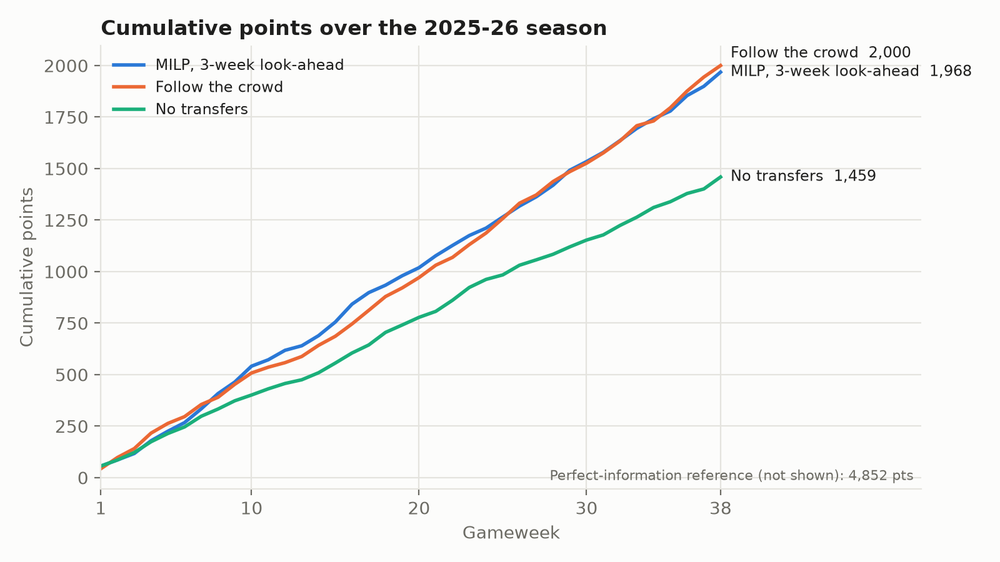

# Fantasy Premier League Season Optimization with MILP

**ISE 3230, Group 5**: Jiho Choi, Suleiman Bainazarov, Ari Palmer

A multi-period mixed-integer linear program (MILP), solved with Gurobi, that plays the full
**2025-26 Fantasy Premier League (FPL)** season week by week and scores every decision with the
**real** points.

---

## 1. Introduction and Motivation

Fantasy Premier League is one of the biggest fantasy games in the world, with 13.1 million managers
playing in the 2025-26 season. The managers at the top of the overall ranking win real prizes. The
champion even gets a seven-night trip to the UK with VIP tickets to two Premier League matches.
Getting close to that level takes good decisions every week. Each week a manager has to choose which
11 players to start from their 15-player squad and who will be captain for double points. They also
need to decide whether a transfer is worth losing 4 points. This might sound simple, but there are
about 700 players to choose from, which means there are roughly $`10^{28}`$ possible squads that fit
the £100m budget. A player bought this week also stays in the team for the next weeks, so every
decision affects the future. All of these choices have to be made before the matches start. Because
of this, we wanted to see if a math model could make these decisions and help a manager climb closer
to the top, using only the data available before each deadline.

Each manager starts with a £100m budget for the 15-player squad, which must have 2 goalkeepers,
5 defenders, 5 midfielders and 3 forwards, with at most 3 players from one club. The 11 starters must
form a valid formation, with exactly 1 goalkeeper and at least 3 defenders, 2 midfielders and
1 forward. There are 38 gameweeks (GWs) in a season. Each GW gives one free transfer that
can be saved up to 5. Any transfer beyond the free ones costs 4 points, which is called a hit.

**Approach.** Our goal is to maximize the total points over the season while following the FPL rules.
We use a rolling horizon. At the deadline of every GW *t*, we

1. forecast the expected points of every player for the next *H* GWs (*t … t+H−1*), using only data up to GW *t−1*
2. solve the MILP for those *H* weeks
3. carry out only the GW-*t* decisions (squad, starting XI, captain, transfers)
4. score them with the real GW-*t* points, then move to GW *t+1*

Each week the MILP maximizes the expected points of the planned GWs, minus the hit penalties. The
season total is what we get when those decisions are scored with the real points.

*H* is the number of GWs the model plans ahead. Our model uses *H* = 3 (this week and the next two).
We chose this number at the start and did not tune it. In the results we first show what our model
did over the season and how many points it scored. As planned in our proposal, we then compare its
points with simpler strategies, such as never making a transfer. Finally, as a post-optimality
analysis, we change *H* from 1 to 10 and check how the season points change.

---

## 2. Decision Variables

For every candidate player *p* and every planned gameweek *g* (the sets are defined in Section 3.1):

| Variable | Domain | Meaning |
|---|---|---|
| $`x_{p,g}`$ | $`\{0, 1\}`$ | 1 if player *p* is in the 15-man squad in GW *g* |
| $`y_{p,g}`$ | $`\{0, 1\}`$ | 1 if *p* is in the starting XI |
| $`c_{p,g}`$ | $`\{0, 1\}`$ | 1 if *p* is captain |
| $`b_{p,g}`$ | $`\{0, 1\}`$ | 1 if *p* is bought before GW *g* |
| $`s_{p,g}`$ | $`\{0, 1\}`$ | 1 if *p* is sold before GW *g* |
| $`ft_g`$ | $`\{0, 1, \dots, 5\}`$ | free transfers available in GW *g* |
| $`u_g`$ | $`\{0, 1, 2, \dots\}`$ | free transfers used in GW *g* (integer) |
| $`h_g`$ | $`\{0, 1, 2, \dots\}`$ | number of hits in GW *g* (integer). A hit is a transfer made after the free transfers are used up. Each hit costs 4 points. |
| $`bank_g`$ | $`[0, \infty)`$ | money left after the GW-*g* transfers (£m) |
| $`z_g`$ | $`\{0, 1\}`$ | 1 if any transfer is made in GW *g*. Only needed when a real-life transfer (one of our players moving to another Premier League club during the season) leaves us with more than 3 players from one club (constraint 12) |

The 4 squad players who don't start are the bench. A bench player comes on when a starter doesn't
play, as long as the team still has a valid formation. The vice-captain gets double points if the
captain doesn't play. The vice-captain and the bench order are not variables. After solving, the
vice-captain is the starter
with the second-highest expected points, and the bench is ordered GK first, then by expected points.

---

## 3. Formulation (`model.py`)

### 3.1 Sets and parameters

| Symbol | Meaning |
|---|---|
| $`P`$ | candidate players: all players in the game at the current GW (690 at GW1, up to 841 later) |
| $`G = \{t, \dots, \min(t+H-1,\ 38)\}`$ | planned GWs. *t* is the current GW and *H* is the number of GWs planned ahead (3 in our model). The plan stops at GW38 |
| $`P_k,\ k \in \{\text{GK}, \text{DEF}, \text{MID}, \text{FWD}\}`$ | players of position *k* |
| $`P_c,\ c \in C`$ | players of club *c*, where *C* is the set of the 20 Premier League clubs |
| $`xP_{p,g}`$ | expected points of *p* in GW *g*  |
| $`cost_p`$ | price of *p* at GW *t* (£m), kept fixed for all planned weeks |
| $`sell_p`$ | selling price of an owned player: purchase price + half of any price rise, rounded down to £0.1m, or the current price if the price has fallen (FPL rule). Equal to $`cost_p`$ for players we don't own |
| $`q_k`$ | squad quota: 2, 5, 5, 3 |
| $`L_k, \; U_k`$ | formation limits in the XI: GK 1–1, DEF 3–5, MID 2–5, FWD 1–3 |
| $`S_0, \; B_0, \; F_0`$ | state at the deadline of GW *t*: current squad, bank, free transfers |
| $`e_c = \lvert S_0 \cap P_c \rvert - 3`$ | number of our players at club *c* above 3 (only > 0 after a real-life transfer) |
| $`\delta = 0.9, \; \beta = 0.1, \; \kappa = 4`$ | weekly discount, bench weight, hit cost |

The previous-week values for the first planned week come from the state:
$`x_{p,t-1} = 1`$ if $`p \in S_0`$ (else 0) and $`bank_{t-1} = B_0`$.

### 3.2 Objective

```math
\max \; \sum_{g \in G} \delta^{\,g-t} \Big[ \sum_{p \in P} xP_{p,g}\,(y_{p,g} + c_{p,g})
\;+\; \beta \sum_{p \in P} xP_{p,g}\,(x_{p,g} - y_{p,g}) \;-\; \kappa\, h_g \Big]
```

- $`xP\,(y + c)`$: points of the starting XI; the captain is counted once more, so he scores double
- $`\beta\,xP\,(x - y)`$: a small value for bench players, who come on when a starter doesn't play
- $`\kappa\,h`$: 4 points for every hit
- $`\delta^{g-t}`$: the *H* planned GWs are added up, and later weeks count slightly less because their
  forecasts are less reliable

### 3.3 Constraints

For every $`g \in G`$ (constraints with *p* hold for every $`p \in P`$):

```math
x_{p,g} = x_{p,g-1} + b_{p,g} - s_{p,g} \qquad (1)
```

```math
s_{p,g} \le x_{p,g-1}, \qquad b_{p,g} \le 1 - x_{p,g-1} \qquad (2)
```

```math
bank_g = bank_{g-1} + \sum_{p} sell_p\, s_{p,g} - \sum_{p} cost_p\, b_{p,g}, \qquad bank_g \ge 0 \qquad (3)
```

```math
\sum_{p} x_{p,g} = 15, \qquad \sum_{p \in P_k} x_{p,g} = q_k \quad \forall k \qquad (4)
```

```math
\sum_{p \in P_c} x_{p,g} \le 3 \quad \forall c \text{ with } e_c \le 0 \qquad (5)
```

```math
y_{p,g} \le x_{p,g}, \qquad \sum_{p} y_{p,g} = 11 \qquad (6)
```

```math
L_k \le \sum_{p \in P_k} y_{p,g} \le U_k \quad \forall k \qquad (7)
```

```math
c_{p,g} \le y_{p,g}, \qquad \sum_{p} c_{p,g} = 1 \qquad (8)
```

```math
\sum_{p} b_{p,g} = u_g + h_g \qquad (9)
```

```math
u_g \le ft_g \qquad (10)
```

```math
ft_t = F_0, \qquad ft_g \le ft_{g-1} - u_{g-1} + 1 \;\; (g > t,\ g \ne 16), \qquad ft_{16} = 5 \;\; (\text{if } 16 \in G), \qquad 0 \le ft_g \le 5 \qquad (11)
```

```math
\sum_{p \in P_c} x_{p,g} \le 3 + e_c\,(1 - z_g) \quad \forall c \text{ with } e_c > 0, \qquad \sum_{p} b_{p,g} \le 15\, z_g \qquad (12)
```

| # | Meaning |
|---|---|
| (1) | squad flow: this week's squad = last week's + bought − sold |
| (2) | only an owned player can be sold, only a new player can be bought |
| (3) | budget: money changes only through transfers and can't be negative |
| (4) | 15 players: 2 GK, 5 DEF, 5 MID, 3 FWD |
| (5) | at most 3 players from one club |
| (6) | 11 starters, all from the squad |
| (7) | valid formation: exactly 1 GK, at least 3 DEF, 2 MID, 1 FWD |
| (8) | one captain, who must start |
| (9)–(10) | transfers are free up to $`ft_g`$, the rest are hits |
| (11) | unused free transfers roll over (+1 per week, max 5). FPL gave every manager 5 free transfers in GW16 of 2025-26, so $`ft_{16} = 5`$ |
| (12) | FPL rule: if a real-life transfer leaves us with more than 3 players from one club we may keep them, but any transfer we make must bring that club back to 3. $`z_g`$ switches the looser limit off once a transfer is made |

**GW1.** The squad is picked from scratch, so $`S_0`$ is empty (no players yet) and $`B_0 = 100`$.
In GW1 constraints (9)–(11) do not apply; instead $`u = h = ft = 0`$ and nothing is sold, so the 15
"bought" players are the initial squad. GW2 then starts with 1 free transfer.

**Remarks.**

- In (11) the real rule is an equality. "≤" gives the same optimal value, because having more free
  transfers never lowers the objective.
- **Model size:** for GW1 with H = 3 there are 690 candidates, **10,362 variables and 10,467
  constraints**.

### 3.4 Where the expected points $`xP`$ come from

**Data.** Real 2025-26 season data from [vaastav/Fantasy-Premier-League](https://github.com/vaastav/Fantasy-Premier-League)
(points, prices, minutes, clubs and fixtures of 841 players over 38 GWs), plus last season (2024-25)
totals. No synthetic data. `data_prep.py` cleans it into one row per player
and GW; in double GWs (two matches) the points are summed, and in blank GWs (no match) they are 0.

**Forecast** (`forecast.py`). At the deadline of GW *t*, using only data up to GW *t−1*:

```math
xP_{p,g} \;=\; P(\text{play})_{p} \times \text{PPA}_{p} \times n_{\text{club}(p),\,g}
```

- $`P(\text{play})`$: share of his club's matches in the last 4 GWs that he played in, with recent GWs
  weighted more
- PPA: points per match played over the last 6 GWs
- $`n`$: number of matches his club plays in GW *g* as scheduled at the deadline (0, 1 or 2)
- Both values are also mixed with last season's numbers, which matters most early in the season when
  there is little data. Players with no Premier League history get a value estimated from their price.

$`P(\text{play})`$ and PPA are computed once at the deadline, so every planned GW uses the same two
values. Only $`n`$ changes from week to week.

The 1-week-ahead forecast has a correlation of **0.55** with the real points.

**Expected points at GW1.** At the first deadline there is no 2025-26 data yet, so $`P(\text{play})`$
and PPA come only from last season's data (`players_raw.csv` of 2024-25 from the same source).

- $`P(\text{play})`$ = minutes played last season ÷ (38 × 90), but at least 0.05
- PPA = points last season ÷ (matches played + 2), where matches played is estimated from his starts
  and minutes. The +2 keeps a player who played only a few matches from looking too good.
- 178 of the 690 players at GW1 were not in the Premier League last season. For them, we estimate both
  values from their price, using the link between price and last-season numbers among the other
  players in the same position (players with a higher price usually scored more).

---

## 4. Code

The project runs in six steps, one file each:

| Step | File | What it does |
|---|---|---|
| 1 | `data_prep.py` | cleans the raw data into one table (player × GW) |
| 2 | `forecast.py` | expected points $`xP`$ (Section 3.4) |
| 3 | `model.py` | builds and solves the MILP (Section 3) |
| 4 | `simulate.py` | plays the season with the rolling horizon and scores it with the real points |
| 5 | `baselines.py` | runs the comparison strategies |
| 6 | `analysis.py` | decision table, figures and post-optimality analysis |

### 4.1 Expected points (`forecast.py`)

Points per match played (PPA) and the chance to play are each mixed with last season's value
(`prior`), which acts like a few extra matches of data (`k` = 4 and `k_play` = 0.5 matches).
`p_sum` and `a_sum` are a player's points and matches played over the last 6 GWs. `num` and `den` are
the matches he played and the matches he could have played over the last 4 GWs, with recent GWs
weighted more. `nf` is the number of matches his club plays in GW *g*, so `rate * nf` is $`xP`$.

```python
ppa = (p_sum + k * prior["ppa"]) / (a_sum + k)
```

```python
play = (num + k_play * prior["play"]) / (den + k_play)

rate = (play * ppa).fillna(0)
```

```python
for g in range(t, min(t + horizon, N_GW + 1)):
    nf = known.reindex(pd.MultiIndex.from_arrays([[t] * len(players), club_now.values,
                                                  [g] * len(players)])).values
    out.append(pd.DataFrame({"decision_gw": t, "element": players, "GW": g,
                             "xp": rate.loc[players].values * nf}))
```

### 4.2 Decision variables (`model.py`, Section 2)

`x`, `y`, `c`, `b` and `s` have one Gurobi variable per player and planned GW; `ft`, `u`, `h` and `bank`
have one per planned GW. $`z_g`$ is created only when needed (snippet 4.4).

```python
x = m.addVars(P, G, vtype=GRB.BINARY, name="x")
y = m.addVars(P, G, vtype=GRB.BINARY, name="y")
c = m.addVars(P, G, vtype=GRB.BINARY, name="c")
b = m.addVars(P, G, vtype=GRB.BINARY, name="b")
s = m.addVars(P, G, vtype=GRB.BINARY, name="s")
ft = m.addVars(G, vtype=GRB.INTEGER, lb=0, ub=MAX_FT, name="ft")
u = m.addVars(G, vtype=GRB.INTEGER, lb=0, name="u")
h = m.addVars(G, vtype=GRB.INTEGER, lb=0, name="h")
bank = m.addVars(G, lb=0.0, name="bank")
```

### 4.3 Squad flow and budget, constraints (1)–(3)

`prev(p)` is last week's $`x`$: the current squad $`S_0`$ for the first planned week, otherwise the
variable of the week before.

```python
for i, g in enumerate(G):
    # squad and bank of the previous GW (for the first planned GW: the current ones)
    prev = (lambda p: 1 if p in owned else 0) if i == 0 else (lambda p, gp_=G[i - 1]: x[p, gp_])
    bank_prev = bank0 if i == 0 else bank[G[i - 1]]

    # (1) squad = previous squad + players bought - players sold
    m.addConstrs((x[p, g] == prev(p) + b[p, g] - s[p, g] for p in P), name=f"flow_{g}")
    # (2) only a squad player can be sold, only a player not in the squad can be bought
    m.addConstrs((s[p, g] <= prev(p) for p in P), name=f"sell_owned_{g}")
    m.addConstrs((b[p, g] <= 1 - prev(p) for p in P), name=f"buy_new_{g}")
    # (3) the bank changes only through sales and purchases; it cannot go below 0
    #     (the lower bound 0 is given when bank is created above)
    m.addConstr(bank[g] == bank_prev
                + gp.quicksum(sell_value[p] * s[p, g] for p in P)
                - gp.quicksum(cost[p] * b[p, g] for p in P), name=f"budget_{g}")
```

### 4.4 Squad composition and club limit, constraints (4), (5), (12)

`excess[cl]` is $`e_c`$. For a normal club the limit is 3; for a club above the limit, $`z_g`$ is created
and linked to the number of transfers.

```python
# (4) 15 players: 2 GK, 5 DEF, 5 MID, 3 FWD
m.addConstr(x.sum("*", g) == 15, name=f"squad15_{g}")
for k, q in QUOTA.items():
    m.addConstr(gp.quicksum(x[p, g] for p in P if pos[p] == k) == q, name=f"quota_{k}_{g}")
# (5) at most 3 players from one club
# (12) excess[cl] > 0 when a real-life transfer left more than 3 squad players at a club.
#      They may be kept, but once any transfer is made (z[g] = 1) the club must go back to 3.
excess = {cl: sum(1 for p in owned if club.get(p) == cl) - CLUB_LIMIT for cl in set(club.values())}
for cl in excess:
    members = gp.quicksum(x[p, g] for p in P if club[p] == cl)
    if excess[cl] > 0:
        if g not in z:
            z[g] = m.addVar(vtype=GRB.BINARY, name=f"any_transfer_{g}")
            m.addConstr(b.sum("*", g) <= 15 * z[g], name=f"any_transfer_link_{g}")
        m.addConstr(members <= CLUB_LIMIT + excess[cl] * (1 - z[g]), name=f"club_{cl}_{g}")
    else:
        m.addConstr(members <= CLUB_LIMIT, name=f"club_{cl}_{g}")
```

### 4.5 Starting XI, formation and captain, constraints (6)–(8)

```python
# (6) 11 starters, all from the squad
m.addConstrs((y[p, g] <= x[p, g] for p in P), name=f"start_in_squad_{g}")
m.addConstr(y.sum("*", g) == 11, name=f"xi_{g}")
# (7) valid formation: 1 GK and at least 3 DEF, 2 MID and 1 FWD
for k in QUOTA:
    starters = gp.quicksum(y[p, g] for p in P if pos[p] == k)
    m.addConstr(starters >= MIN_START[k], name=f"minform_{k}_{g}")
    m.addConstr(starters <= MAX_START[k], name=f"maxform_{k}_{g}")
# (8) one captain, who must be a starter
m.addConstrs((c[p, g] <= y[p, g] for p in P), name=f"capt_starter_{g}")
m.addConstr(c.sum("*", g) == 1, name=f"one_captain_{g}")
```

### 4.6 Transfers and free transfers, constraints (9)–(11) and GW1

In GW1 the squad is picked from scratch, so (9)–(11) are not used and $`u = h = ft = 0`$. Nothing can
be sold in GW1, because the squad is still empty (constraint 2). `max_transfers` is used only by the
"no transfers" strategy.

```python
if first_gw and i == 0:
    # GW1: the first 15 players are not transfers, so (9)-(11) are not used
    m.addConstr(h[g] == 0)
    m.addConstr(u[g] == 0)
    m.addConstr(ft[g] == 0)
else:
    # (9) every player bought is either a free transfer or a hit
    m.addConstr(b.sum("*", g) == u[g] + h[g], name=f"transfers_{g}")
    if max_transfers is not None:      # only for the "no transfers" strategy
        m.addConstr(b.sum("*", g) <= max_transfers, name=f"max_transfers_{g}")
    # (10) no more free transfers are used than are available
    m.addConstr(u[g] <= ft[g], name=f"use_free_{g}")
    # (11) the plan starts with ft0; GW16 has 5; otherwise unused free transfers
    #      carry over and one new one is added (the limit of 5 is given when ft is created above)
    if i == 0:
        m.addConstr(ft[g] == ft0, name="ft_start")
    elif g == AFCON_GW:
        m.addConstr(ft[g] == MAX_FT, name="ft_afcon")
    else:
        g0 = G[i - 1]
        m.addConstr(ft[g] <= ft[g0] - u[g0] + 1, name=f"ft_roll_{g}")
```

### 4.7 Objective and solve (Section 3.2)

`discount ** i` is $`\delta^{g-t}`$, `bench_w` is $`\beta`$, `hit_cost` is $`\kappa`$.

```python
obj = gp.LinExpr()
for i, g in enumerate(G):
    w = discount ** i
    obj += w * gp.quicksum(xp[p, g] * (y[p, g] + c[p, g]) for p in P)
    obj += w * bench_w * gp.quicksum(xp[p, g] * (x[p, g] - y[p, g]) for p in P)
    obj -= w * hit_cost * h[g]
m.setObjective(obj, GRB.MAXIMIZE)

m.optimize()
```

Gurobi stops when the solution is proven to be within 0.01 % of the optimum, or after `time_limit`
(120 s by default).

```python
m.Params.TimeLimit = time_limit
m.Params.MIPGap = 1e-4
```

In every run in this report, every weekly model stopped because of the 0.01 % gap and never because of
the time limit, so every weekly decision is optimal for its model (column `optimal` in
`results/season_*.csv`).

### 4.8 Rolling horizon and real scoring (`simulate.py`)

Each GW: build the inputs from the current squad, solve, carry out only the GW-*t* transfers, then
score the team with the real points. `score_gw` applies the FPL rules: captain double (vice-captain if
the captain doesn't play) and automatic substitutions from the bench. `plan_hit_cost` is used only by
"follow the crowd" (Section 4.9). The real score always takes 4 points per hit.

```python
for t in range(1, N_GW + 1):
    info = by_gw[t]
    P, G, xpd, price, pos, club, pname = M.build_inputs(df, xp, t, horizon, owned=squad)
    sell = {p: selling_price(bought_at[p], price[p]) if p in bought_at else price[p] for p in P}

    tic = time.time()
    r = M.solve(t, P, G, xpd, price, sell, pos, club, squad0=squad, bank0=bank, ft0=ft,
                hit_cost=M.HIT_COST if plan_hit_cost is None else plan_hit_cost,
                max_transfers=max_transfers)
    solve_time = time.time() - tic

    # carry out the GW-t transfers (the bank is recomputed with the FPL prices)
    for p in r["sells"]:
        bank += sell[p]
        bought_at.pop(p)
    for p in r["buys"]:
        bank -= price[p]
        bought_at[p] = price[p]
    bank = round(bank, 1)
    squad = r["squad"]

    # vice-captain: the starter with the highest expected points in GW t after the captain
    vice = sorted([p for p in r["lineup"] if p != r["captain"]], key=lambda p: -xpd[p, t])[0]
    pts = score_gw(r["lineup"], r["bench"], r["captain"], vice, info["position"],
                   info["minutes"], info["points"])
    pts -= M.HIT_COST * r["hits"]
```

### 4.9 Comparison strategies (`baselines.py`)

All strategies use the same simulation and scoring. They differ only in what the model is given.
"No transfers" allows no transfers after GW1 and picks its GW1 squad by looking 10 GWs ahead, the
longest forecast we have. "Follow the crowd" replaces $`xP`$ with ownership (how many FPL managers have
the player in their team) and allows free transfers only (a hit cost of 1,000 in the plan).
"Perfect information" replaces $`xP`$ with the real points.

```python
logs["no_transfers"] = S.run_season(df, xp, "no_transfers", horizon=hold_horizon, max_transfers=0,
                                    verbose=False)
crowd_df = ownership(df)
logs["crowd"] = S.run_season(df, xp_from_values(crowd_df, "selected", 1), "crowd", horizon=1,
                             plan_hit_cost=1000, verbose=False)  # a hit cost of 1000: free transfers only
logs["milp_H3"] = S.run_season(df, xp, "milp_H3", horizon=3, verbose=False)
logs["perfect_H3"] = S.run_season(df, xp_from_values(df, "points", 3), "perfect_H3", horizon=3,
                                  verbose=False)
```

### 4.10 Post-optimality: number of GWs planned ahead (`analysis.py`)

The whole season is played again for every *H* from 1 to 10 with the same code. Only the number of
planned GWs changes.

```python
for H in horizons:
    log = S.run_season(df, xp, f"sens_H{H}", horizon=H, verbose=False)
    rows.append({"horizon": H, "total_points": int(log.points.sum()),
                 "transfers": int(log.transfers.sum()), "hits": int(log.hits.sum()),
                 "solve_time_s": round(log.solve_time.sum(), 1)})
```

---

## 5. Results

### 5.1 What our model did over the season

Our model planned 3 GWs ahead at every deadline and finished the season with **1,968 points**. Each
week it chose the squad, the starting XI, the captain and the transfers. The table below sums up what
it did. Every week's team and transfers are listed in
[`results/season_milp_H3.md`](results/season_milp_H3.md).

| | Over the 38 GWs |
|---|---|
| Season points | **1,968** (2,028 before the 60 points lost to hits) |
| Transfers | 56, at least one in every GW from GW2 |
| Hits | 15 (−60 points), in 11 different GWs |
| Free transfers | always used, never saved. The 5 free transfers given in GW16 were all used that week |
| Captain | 16 different players. Haaland 7 times, Salah 6 times |
| Expected vs real points of the starting XI | 2,469 expected, 2,028 real (hit penalties not included in either) |
| Solve time | 0.1–1.3 s per GW. Every GW was solved to optimality |

- In GW1 the model spent the whole £100m. It took 3 players each from Liverpool and Nott'm Forest,
  the most the rules allow.
- It filled the bench with the cheapest players (£4.0–4.5m) and spent the money on the starting XI,
  because bench players count only 10 % in the objective.
- Its starting XI scored 18 % less than expected (2,028 vs 2,469), so the forecast is too optimistic.

### 5.2 Strategy comparison

Every strategy plays all 38 GWs and is scored with the real points (`results/summary.csv`).

| Strategy | Description | Season points | Transfers | Hits | Captain points (before doubling) |
|---|---|---|---|---|---|
| No transfers | picks the best GW1 squad and never changes it | 1,459 | 0 | 0 | 155 |
| **Our model** | **plans 3 GWs ahead** | **1,968** | 56 | 15 | 190 |
| Follow the crowd | copies the players most FPL managers own, using free transfers only | 2,000 | 41 | 0 | 159 |
| Perfect information (not possible in reality) | Same MILP, but uses the real points of the next 3 GWs instead of expected points | 4,852 | 245 | 204 | 653 |



- **Transfers matter.** Never transferring scores 509 points less than our model.
- **Follow the crowd is 32 points ahead.** Before hit penalties our model scores 2,028
  (1,968 + 15 × 4), more than the crowd's 2,000. The difference comes from the 15 hits our model takes.
  Our model's captains score more (190 vs 159). Ownership may also reflect news our forecast doesn't
  use, such as injuries and team selection.
- **Perfect information is not achievable.** It shows the score if the next 3 GWs were known
  exactly. The large gap (4,852 vs 1,968) means the limit is the forecast, not the optimization.

### 5.3 Post-optimality: number of GWs planned ahead

Our model plans 3 GWs ahead, a number we chose at the start. To see how this choice affects the
result, the full season was played again with *H* = 1 … 10 (`results/sens_horizon.csv`). The objective value
can't be used to compare different *H*, because a longer plan adds more weeks to the sum and so always
has a larger objective. We compare the real season points instead.

| GWs planned ahead (*H*) | 1 | 2 | **3 (our model)** | 4 | **5** | 6 | 7 | 8 | 9 | 10 |
|---|---|---|---|---|---|---|---|---|---|---|
| Season points | 1,913 | 1,930 | 1,968 | 1,972 | **2,010** | 1,919 | 1,959 | 1,963 | 1,939 | 1,939 |
| Hits taken | 7 | 11 | 15 | 19 | 20 | 21 | 23 | 22 | 26 | 23 |
| Season solve time (s) | 3 | 9 | 19 | 37 | 61 | 100 | 126 | 222 | 318 | 354 |


- **Planning 5 GWs ahead scores the most**, 2,010 points. That is 42 more than our model and 10 more than
  following the crowd.
- **A longer plan is not always better.** After H = 5 the points drop to 1,919 and then go up and down.
  The curve is not smooth, so part of the differences between values of H is likely noise from one
  season.
- **Longer plans take more hits and more time.** Hits rise from 7 at H = 1 to 20–26 for H ≥ 5. At
  H = 10 the slowest week takes 56 s, but every week was still solved to optimality.

### 5.4 Conclusion and limitations

Our model, planning 3 GWs ahead, scores 1,968 points. That is 509 more than never transferring and
32 fewer than following the crowd. The post-optimality analysis shows that planning 5 GWs ahead
instead raises the score to 2,010, about the same as the crowd. The large gap to perfect information
shows that a better forecast would help more than a different number of planned GWs.

Limitations:

- **No chips** (Wildcard, Free Hit, Bench Boost, Triple Captain), which real managers use for extra points.
- **Simple forecast** from past points and minutes only: no injury news, team news or opponent strength.
- **Prices are fixed** within the planning window. Real price changes are applied week to week.
- The discount (0.9) and bench weight (0.1) were set by judgment, not tuned.
- **Planning 5 GWs ahead was found best on the same season it is scored on**, so its 2,010 points may
  be optimistic.
- **One season only**, so differences of a few dozen points may partly be noise.

---

## How to run

**Requirements**: Python 3, `pandas`, `numpy`, `matplotlib`, `gurobipy`, and a **Gurobi academic
license**. The free pip license is limited to 2,000 variables, which is too small for this model.

```bash
python data_prep.py    # clean data -> data/processed/player_gw.csv, fixtures_known.csv   (~10 s)
python forecast.py     # expected points -> data/processed/xp.csv                          (~10 s)
python model.py        # demo: optimal GW1 squad                                           (~1 s)
python simulate.py     # full season with our model (plans 3 GWs ahead)                     (~20 s)
python baselines.py    # all 4 strategies -> results/summary.csv                           (~1 min)
python analysis.py     # decision table, figures, post-optimality analysis on H = 1..10    (~20 min)
python analysis.py A   # (or only one part: A or B)
```

## Repository structure

```
├── data_prep.py        # Step 1  clean data -> player × GW table
├── forecast.py         # Step 2  expected points
├── model.py            # Step 3  MILP (gurobipy)
├── simulate.py         # Step 4  rolling-horizon season simulation + FPL scoring
├── baselines.py        # Step 5  comparison strategies
├── analysis.py         # Step 6  post-optimality analysis + figures
├── data/
│   ├── raw/            # original files from vaastav/Fantasy-Premier-League + fixture_changes.csv
│   └── processed/      # player_gw.csv, fixtures_known.csv, xp.csv
└── results/
    ├── season_*.csv    # week-by-week log of every run (squad, XI, bench, captain, vice, transfers,
    │                   #   points, solve time, whether Gurobi proved optimality)
    ├── season_milp_H3.md # our model's season as a readable table
    ├── summary.csv     # strategy comparison
    ├── sens_horizon.csv  # post-optimality analysis on H
    └── figures/        # fig1–fig2
```
