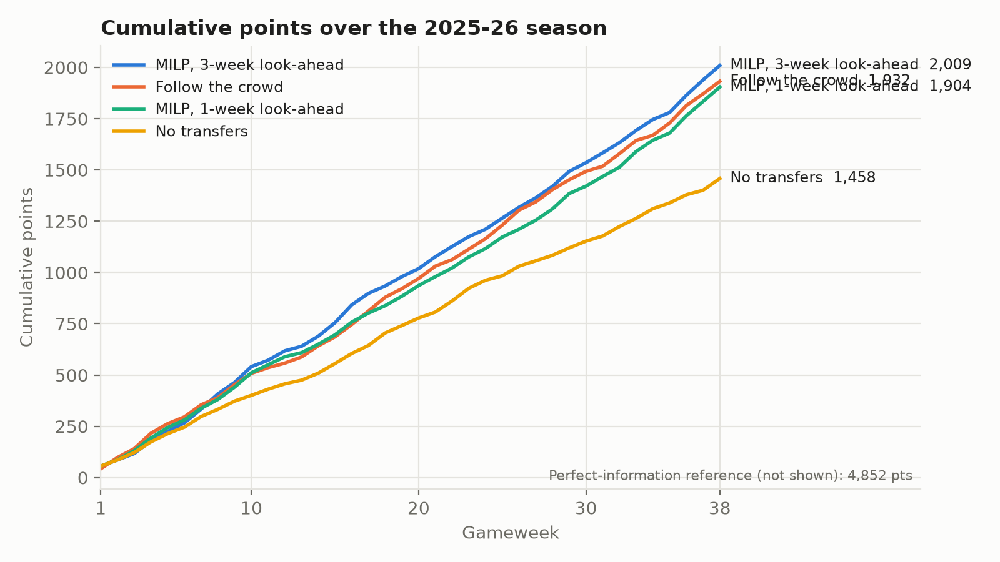
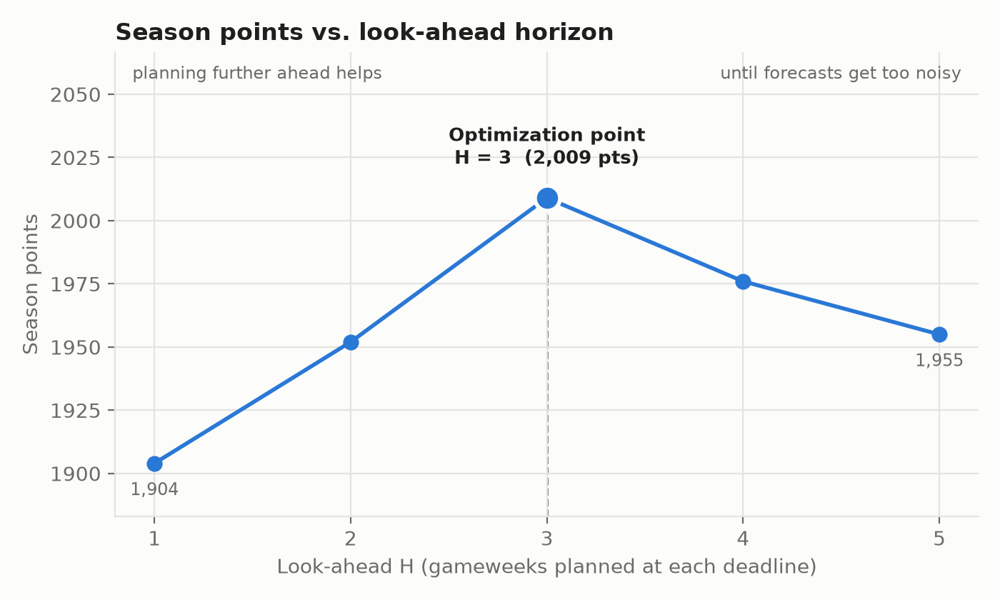
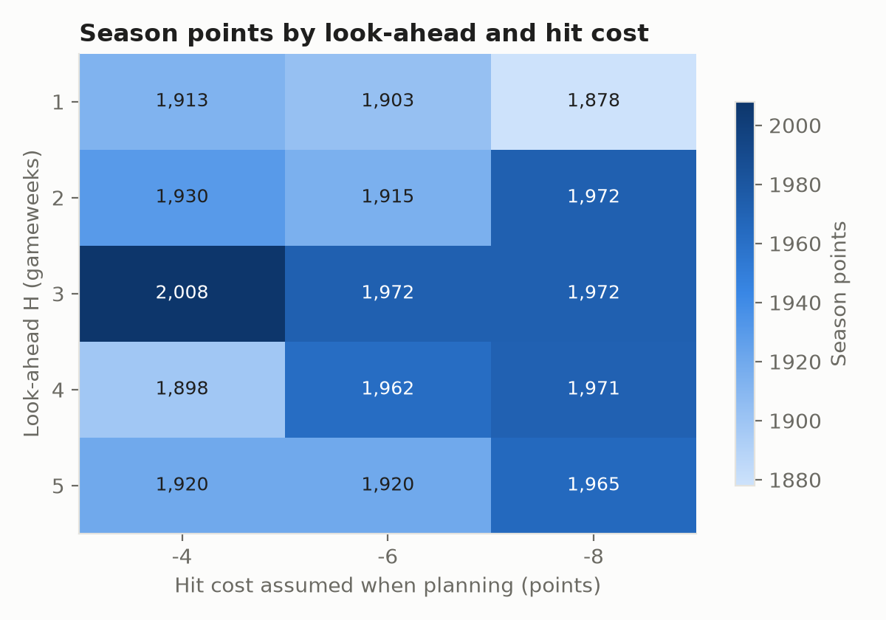
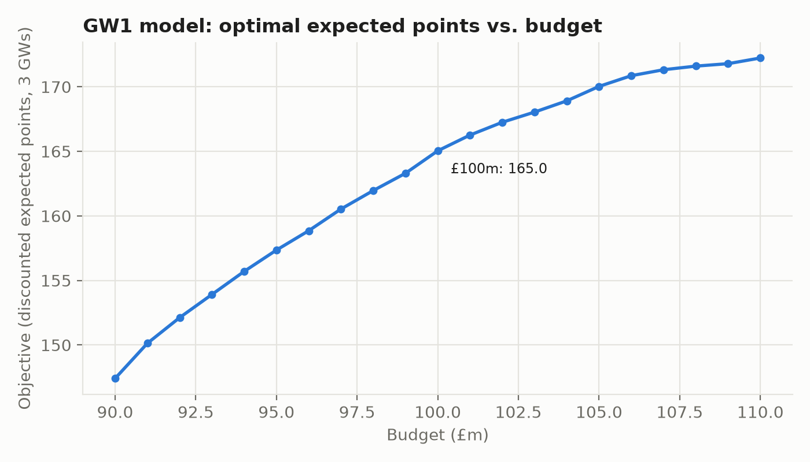
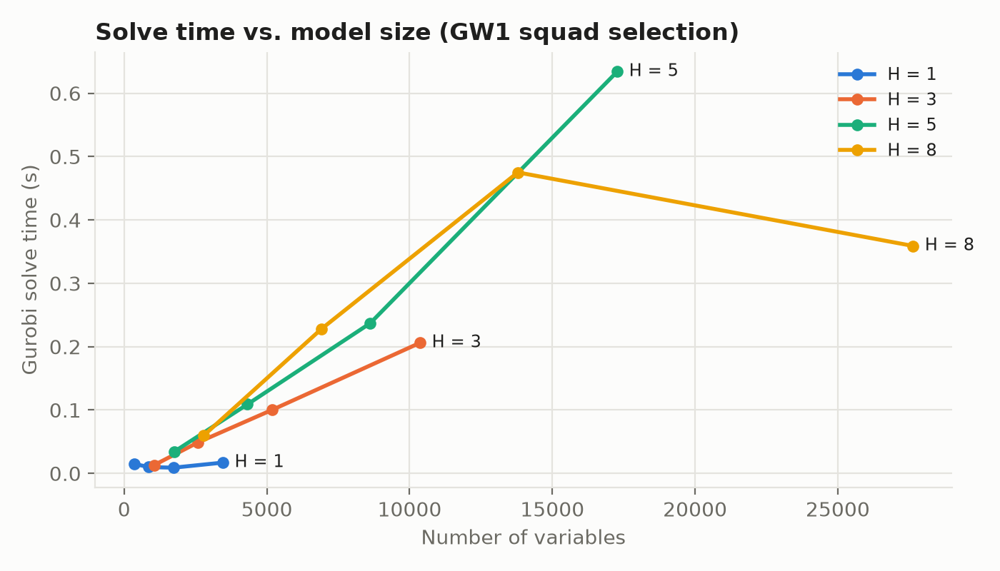
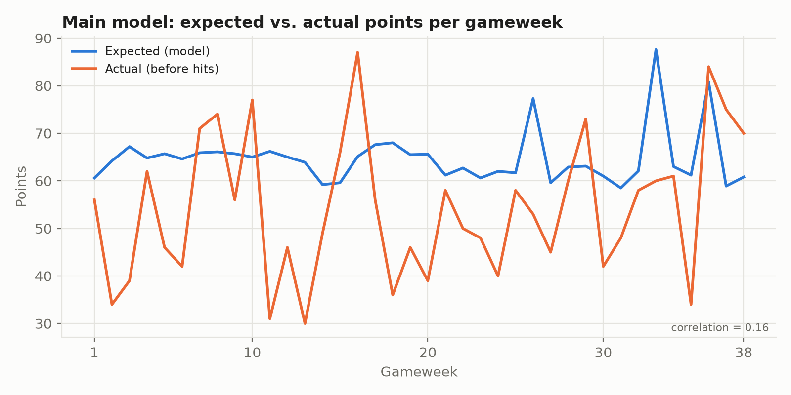

# Fantasy Premier League Season Optimization with MILP

A multi-period mixed-integer linear program (MILP), solved with Gurobi, that plays the full
**2025-26 Fantasy Premier League (FPL)** season week by week and scores every decision with the
**real** points. Looking 3 gameweeks ahead, it scores **2,009 points**, more than every simpler
strategy we tested.

---

## 1. Problem

In FPL, a manager has a **£100m budget** to build a **15-player squad**. Before each of the
38 gameweeks (GWs) the manager decides:

- which **11 players start**, and in which formation
- who is **captain** (scores double)
- which players to **buy and sell**. Each GW gives 1 free transfer, unused ones roll over
  (max 5), and every extra transfer costs **4 points**.

The goal is to **maximize total points over the season**. These decisions must be made
**before** the matches are played, so real points are unknown when deciding.

**Approach: rolling horizon.** At the deadline of every GW *t*:

1. forecast expected points for GW *t … t+H−1* using only data up to GW *t−1*
2. solve the MILP for those *H* weeks
3. carry out **only the GW-*t*** decisions (squad, XI, captain, transfers)
4. score them with the real GW-*t* points, then move to GW *t+1*

The result is not a single "best team". It is a **decision method** that produces 38 weeks of
teams, and we compare that method with simpler ways of playing.

---

## 2. Data

Source: [vaastav/Fantasy-Premier-League](https://github.com/vaastav/Fantasy-Premier-League)

| File (`data/raw/`) | Season | Used for |
|---|---|---|
| `merged_gw.csv` | 2025-26 | points, price, minutes, club and ownership of every player in every match |
| `fixtures.csv` | 2025-26 | number of matches each club plays in each GW |
| `teams.csv` | 2025-26 | club names |
| `players_raw_2526.csv` | 2025-26 | player id ↔ code (to link with last season) |
| `players_raw_2425.csv` | 2024-25 | last season's points and minutes (starting values for GW1) |

| File (`data/processed/`) | Made by | Content |
|---|---|---|
| `player_gw.csv` | `data_prep.py` | one row per player × GW (841 players × 38 GWs = 31,958 rows) |
| `xp.csv` | `forecast.py` | expected points made at each GW deadline for the next 8 GWs |

**Data issues handled**

- **Duplicate rows**: 10 rows recorded the same player and match twice. They were removed.
- **Double GWs** (26, 33, 36): a player can have 2 matches in one GW, so his points are summed.
- **Blank GWs** (31, 34): a player whose club has no match has no row, so he gets 0 points.
- **Players joining mid-season**: they can't be picked before their first GW (`available = 0`).
- **Club changes**: 27 players moved clubs during the season, so the club is taken per GW.
- **Players who left the league**: they stay in the data with 0 minutes (e.g. Luis Díaz).
  The playing-probability term below handles this.

---

## 3. Expected points (forecast)

At the deadline of GW *t*, using **only GW 1 … t−1**:

$$
\text{xP}_{p,g} \;=\; \underbrace{P(\text{play})_{p,t}}_{\text{chance to play}} \times
\underbrace{\text{PPA}_{p,t}}_{\text{points per appearance}} \times
\underbrace{n_{\text{club}(p),g}}_{\text{matches in GW } g\ (0,1,2)}
$$

- **P(play)** is the recency-weighted share of recent club matches the player played in (the
  last match counts most). In the data, a player who missed his last 2 matches plays the next
  one only about 5 % of the time.
- **PPA** is points per appearance over the last 6 GWs.
- Both are **shrunk toward a prior** taken from last season (2024-25). Players with no PL history
  get a prior predicted from their price.
- The **number of matches** comes from the published fixture list, so blank and double GWs are
  known in advance.

1-week-ahead accuracy: **correlation 0.55, MAE 1.01 points**. For comparison, FPL's own `xP`
column in the data reaches 0.34.

---

## 4. MILP model (`model.py`)

**Sets.** *P* = candidate players, *G* = {t, …, t+H−1} = planning gameweeks

**Decision variables** (for each *p ∈ P*, *g ∈ G*)

| Variable | Type | Meaning |
|---|---|---|
| x<sub>p,g</sub> | binary | p is in the 15-man squad |
| y<sub>p,g</sub> | binary | p is in the starting XI |
| c<sub>p,g</sub> | binary | p is captain |
| b<sub>p,g</sub>, s<sub>p,g</sub> | binary | p is bought / sold before GW g |
| ft<sub>g</sub> | integer 0–5 | free transfers available |
| u<sub>g</sub> | integer | free transfers used |
| h<sub>g</sub> | integer | paid transfers ("hits", −4 each) |
| bank<sub>g</sub> | continuous ≥ 0 | money left |

**Objective**: maximize discounted expected points minus hit penalties

$$
\max \sum_{g\in G} 0.9^{\,g-t}\Big[\sum_{p}\text{xP}_{p,g}\,(y_{p,g}+c_{p,g})
\;+\;0.1\sum_{p}\text{xP}_{p,g}\,(x_{p,g}-y_{p,g}) \;-\; 4\,h_g\Big]
$$

(starters + captain bonus, a small value for bench cover, minus transfer penalties)

**Constraints** (for every *g*)

| Constraint | Formula |
|---|---|
| Squad flow | x<sub>p,g</sub> = x<sub>p,g−1</sub> + b<sub>p,g</sub> − s<sub>p,g</sub> |
| Sell only owned / buy only new | s<sub>p,g</sub> ≤ x<sub>p,g−1</sub>, b<sub>p,g</sub> ≤ 1 − x<sub>p,g−1</sub> |
| Budget | bank<sub>g</sub> = bank<sub>g−1</sub> + Σ sell<sub>p</sub>·s<sub>p,g</sub> − Σ cost<sub>p</sub>·b<sub>p,g</sub> ≥ 0 (initial £100m) |
| Squad size & positions | Σ x = 15; GK = 2, DEF = 5, MID = 5, FWD = 3 |
| Club limit | ≤ 3 players per club (a player who moved into a club may be kept, but no more can be added) |
| Starting XI | y ≤ x; Σ y = 11; GK = 1, DEF ≥ 3, MID ≥ 2, FWD ≥ 1 |
| Captain | c ≤ y; Σ c = 1 |
| Transfers | Σ<sub>p</sub> b<sub>p,g</sub> = u<sub>g</sub> + h<sub>g</sub>; u<sub>g</sub> ≤ ft<sub>g</sub> |
| Free-transfer roll-over | ft<sub>g</sub> ≤ ft<sub>g−1</sub> − u<sub>g−1</sub> + 1, ft<sub>g</sub> ≤ 5; ft = 5 at GW16 (2025-26 rule) |

**Selling price** (FPL rule): purchase price + ½ of any rise, rounded down to £0.1m. In the
rolling horizon this is a known constant for every owned player.

**Size.** With all ~700 candidates and H = 3 the model has **≈10,400 variables and ≈10,500
constraints**. It solves in **0.25–1.4 s**, and the **LP-relaxation gap at GW1 is 0 %**, so the
formulation is tight.

**Scoring** (`simulate.py`) follows real FPL rules:

- the captain scores double, or the vice-captain if the captain doesn't play
- **automatic substitutions** from the bench, keeping a valid formation
- −4 per hit

---

## 5. Results

### 5.1 Strategy comparison (`baselines.py`)

| Strategy | Description | Season points |
|---|---|---|
| No transfers | best GW1 squad (8-week look-ahead), never transfer | 1,458 |
| MILP, 1-week look-ahead | same model, H = 1 | 1,904 |
| Follow the crowd | move toward the most-owned squad with free transfers | 1,932 |
| **MILP, 3-week look-ahead** | **main model, H = 3** | **2,009** |
| Perfect information (reference) | same model fed with the real future points | 4,852 |

The perfect-information run is **not achievable**. It shows how much is lost because the future
is unknown.



### 5.2 Look-ahead H × planned hit cost (`analysis.py`, part B)

The real penalty is always −4. The "planned" hit cost makes the model more cautious about
transfers.

| H \ planned hit cost | −4 | −6 | −8 |
|---|---|---|---|
| 1 | 1,904 | 1,898 | 1,879 |
| 2 | 1,952 | 1,957 | 2,003 |
| **3** | **2,009** | 1,972 | 1,976 |
| 4 | 1,976 | 1,962 | 1,971 |
| 5 | 1,955 | 1,932 | 1,965 |

**Season points rise, peak at H = 3, then fall** (−4 column: 1,904 → 1,952 → **2,009** → 1,976 → 1,955).

- **Rising**: planning ahead prepares for blank and double GWs and avoids transfers that have
  to be reversed a week later.
- **Falling**: forecasts further in the future are less accurate, so a longer plan is built on
  noisier information.

**Optimization point: H = 3** (2,009 points)





### 5.3 Budget (part C)

| Budget | £95m | £100m | £105m |
|---|---|---|---|
| Season points | 1,897 | 2,009 | 2,010 |

A smaller budget costs 112 points, but extra budget adds almost nothing.



### 5.4 Shadow prices and player sensitivity, GW1 model (part D)

- **LP-relaxation shadow prices**: £1m of extra budget is worth **≈1.44 expected points**; the
  captain constraint ≈5.89; one more starter ≈2.64 (`results/lp_duals_gw1.csv`).
- **Ban / force-in test** (`results/player_sensitivity_gw1.csv`): re-solve the MILP with one
  player forced out or in.
  - Banning **Salah** lowers the objective most (−5.82). He is the hardest player to replace.
  - Forcing **Haaland** in costs −7.59. At GW1 he cannot fit in the budget alongside Salah.

### 5.5 Model size vs. solve time (part E)

| Look-ahead H | Variables (all candidates) | Solve time, GW1 | Solve time, GW20 |
|---|---|---|---|
| 1 | ≈3,500–4,000 | 0.02 s | 0.05 s |
| 3 | ≈10,400–11,900 | 0.25 s | 1.4 s |
| 5 | ≈17,300–19,800 | 0.7 s | 7.5 s |
| 8 | ≈27,600–31,600 | 0.3 s | 17.3 s |



### 5.6 Expected vs. actual points (part F)



---

## 6. How to run

**Requirements**: Python 3, `pandas`, `numpy`, `matplotlib`, `gurobipy`, and a **Gurobi academic
license**. The free pip license is limited to 2,000 variables, which is too small for this model.

```bash
python data_prep.py    # download raw data, build data/processed/player_gw.csv   (~10 s)
python forecast.py     # expected points -> data/processed/xp.csv                (~10 s)
python model.py        # demo: optimal GW1 squad                                 (~1 s)
python simulate.py     # full season with the main model (H = 3)                 (~20 s)
python baselines.py    # all 5 strategies -> results/summary.csv                 (~1 min)
python analysis.py     # sensitivity analysis + figures                          (~10–15 min)
python analysis.py G   # (or only some parts: A–G)
```

---

## 7. Repository structure

```
├── data_prep.py        # Step 1  clean data -> player × GW table
├── forecast.py         # Step 2  expected points
├── model.py            # Step 3  MILP (gurobipy)
├── simulate.py         # Step 4  rolling-horizon season simulation + FPL scoring
├── baselines.py        # Step 5  comparison strategies
├── analysis.py         # Step 6  post-optimality analysis + figures
├── data/
│   ├── raw/            # original files from vaastav/Fantasy-Premier-League
│   └── processed/      # player_gw.csv, xp.csv
└── results/
    ├── season_*.csv    # week-by-week log of every run
    ├── summary.csv     # strategy comparison
    ├── sens_*.csv, lp_duals_gw1.csv, player_sensitivity_gw1.csv, model_size_time.csv
    └── figures/        # fig1–fig6
```

---

## 8. Assumptions and limitations

- **No chips**: Wildcard, Free Hit, Bench Boost and Triple Captain are not used. Real managers
  gain extra points from them.
- **Simple forecast**: it uses past points and minutes only. There is no injury news, team news
  or opponent strength.
- **Prices are fixed within the planning window**. Real price changes are applied week to week.
- **One season**: results come from a single season (2025-26). Differences of a few dozen points
  between settings may partly be noise.
- **Vice-captain** = the starter with the second-highest expected points. **Bench order** = GK
  first, then by expected points.
