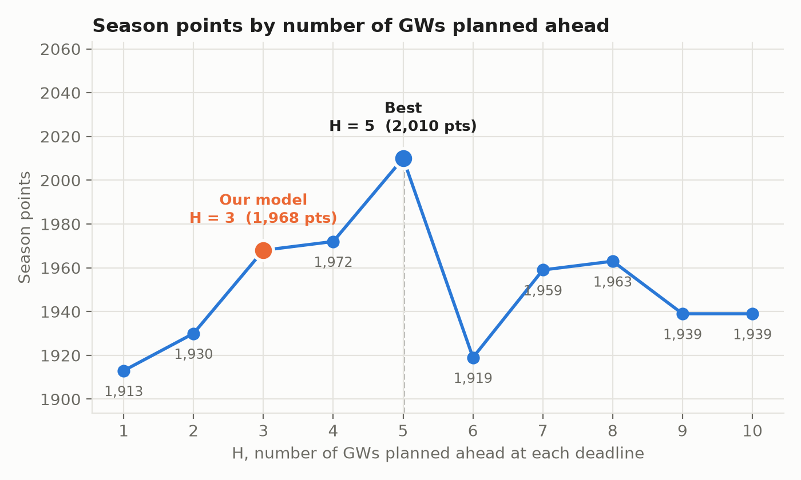

# Fantasy Premier League Season Optimization with MILP

A multi-period mixed-integer linear program (MILP), solved with Gurobi, that plays the full
**2025-26 Fantasy Premier League (FPL)** season week by week and scores every decision with the
**real** points. With a 3-gameweek look-ahead it scores **1,968 points**: well above never transferring
or planning only 1 week ahead, but 32 points below simply following the most-owned players.

---

## 1. Motivation and problem

FPL is the official fantasy game of the English Premier League. In 2025-26 more than
**13 million teams** took part, and top managers win prizes such as a 7-night trip to the UK.
Every week, each manager makes the same decision under uncertainty: pick a team within a budget
before the matches are played. That makes it a natural fit for integer optimization.

In FPL, a manager has a **£100m budget** to build a **15-player squad**. Before each of the
38 gameweeks (GWs) the manager decides:

- which **11 players start**, and in which formation
- who is **captain** (scores double)
- which players to **buy and sell**. Each GW gives 1 free transfer, unused ones roll over
  (max 5), and every extra transfer costs **4 points**.

The goal is to **maximize total points over the season**. These decisions must be made
**before** the matches are played, so real points are unknown when deciding.

**Approach: rolling horizon.** At the deadline of every GW *t*:

1. forecast expected points for GW *t … t+H−1* using only data up to GW *t−1*
2. solve the MILP for those *H* weeks
3. carry out **only the GW-*t*** decisions (squad, XI, captain, transfers)
4. score them with the real GW-*t* points, then move to GW *t+1*

The result is not a single "best team". It is a **decision method** that produces 38 weeks of
teams, and we compare that method with simpler ways of playing.

---

## 2. Data

Source: [vaastav/Fantasy-Premier-League](https://github.com/vaastav/Fantasy-Premier-League)

| File (`data/raw/`) | Season | Used for |
|---|---|---|
| `merged_gw.csv` | 2025-26 | points, price, minutes, club and ownership of every player in every match |
| `fixtures.csv` | 2025-26 | number of matches each club plays in each GW |
| `teams.csv` | 2025-26 | club names |
| `players_raw_2526.csv` | 2025-26 | player id ↔ code (to link with last season) |
| `players_raw_2425.csv` | 2024-25 | last season's points and minutes (starting values for GW1) |
| `fixture_changes.csv` | 2025-26 | the 5 rescheduled matches and when each change was officially announced (compiled by us, with source links) |

| File (`data/processed/`) | Made by | Content |
|---|---|---|
| `player_gw.csv` | `data_prep.py` | one row per player × GW (841 players × 38 GWs = 31,958 rows) |
| `fixtures_known.csv` | `data_prep.py` | matches per club in each future GW, as known at each GW deadline |
| `xp.csv` | `forecast.py` | expected points made at each GW deadline for the next 8 GWs |

**Data issues handled**

- **Duplicate rows**: 10 rows recorded the same player and match twice. They were removed.
- **Double GWs** (26, 33, 36): a player can have 2 matches in one GW, so his points are summed and
  the matches he actually played are counted per match (`apps`).
- **Blank GWs** (31, 34): a player whose club has no match has no row, so he gets 0 points.
- **Players joining mid-season**: they can't be picked before their first GW (`available = 0`).
- **Club changes**: 27 players moved clubs during the season, so the club is taken per GW.
- **Players who left the league**: they stay in the data with 0 minutes (e.g. Luis Díaz).
  The playing-probability term below handles this.

---

## 3. Expected points (forecast)

At the deadline of GW *t*, using **only GW 1 … t−1**:

$$
\text{xP}_{p,g} \;=\; \underbrace{P(\text{play})_{p,t}}_{\text{chance to play}} \times
\underbrace{\text{PPA}_{p,t}}_{\text{points per appearance}} \times
\underbrace{n_{\text{club}(p),g}}_{\text{matches in GW } g\ (0,1,2)}
$$

- **P(play)**: how often the player played in his club's recent matches (recent matches count more)
- **PPA**: his average points per match played over the last 6 GWs
- Both are mixed with last season's (2024-25) numbers, which matter most early in the season.
  Players with no PL history last season get a value estimated from their price.
- **Number of matches**: from the fixture list **as known at the deadline**. Five matches were moved
  during the season; a move is used only after it was officially announced. Before that the match
  stays in its original GW, and while postponed without a new date it counts in no GW.

1-week-ahead accuracy: correlation **0.55** with the real points.

---

## 4. MILP model (`model.py`)

**Sets.** *P* = candidate players, *G* = {t, …, t+H−1} = planning gameweeks

**Decision variables** (for each *p ∈ P*, *g ∈ G*)

| Variable | Type | Meaning |
|---|---|---|
| x<sub>p,g</sub> | binary | p is in the 15-man squad |
| y<sub>p,g</sub> | binary | p is in the starting XI |
| c<sub>p,g</sub> | binary | p is captain |
| b<sub>p,g</sub>, s<sub>p,g</sub> | binary | p is bought / sold before GW g |
| ft<sub>g</sub> | integer 0–5 | free transfers available |
| u<sub>g</sub> | integer | free transfers used |
| h<sub>g</sub> | integer | paid transfers ("hits", −4 each) |
| bank<sub>g</sub> | continuous ≥ 0 | money left |
| z<sub>g</sub> | binary | any transfer made in GW g (only needed when a club is over 3, see club limit) |

**Objective**: maximize discounted expected points minus hit penalties

$$
\max \sum_{g\in G} 0.9^{\,g-t}\Big[\sum_{p}\text{xP}_{p,g}\,(y_{p,g}+c_{p,g})
\;+\;0.1\sum_{p}\text{xP}_{p,g}\,(x_{p,g}-y_{p,g}) \;-\; 4\,h_g\Big]
$$

- xP · (y + c): points of the starting XI, plus the captain counted once more (double)
- **0.1 × bench**: a small value for bench players, who come in when a starter doesn't play
  (automatic substitution)
- **0.9<sup>g−t</sup>**: later weeks count slightly less, because their forecasts are less reliable
- **−4 h**: penalty for each extra transfer

**Constraints** (for every *g*)

| Constraint | Formula |
|---|---|
| Squad flow | x<sub>p,g</sub> = x<sub>p,g−1</sub> + b<sub>p,g</sub> − s<sub>p,g</sub> |
| Sell only owned / buy only new | s<sub>p,g</sub> ≤ x<sub>p,g−1</sub>, b<sub>p,g</sub> ≤ 1 − x<sub>p,g−1</sub> |
| Budget | bank<sub>g</sub> = bank<sub>g−1</sub> + Σ sell<sub>p</sub>·s<sub>p,g</sub> − Σ cost<sub>p</sub>·b<sub>p,g</sub> ≥ 0 (initial £100m) |
| Squad size & positions | Σ x = 15; GK = 2, DEF = 5, MID = 5, FWD = 3 |
| Club limit | ≤ 3 players per club. FPL rule: if a real-life transfer leaves 4, they may be kept, but any transfer must bring the club back to 3: Σ<sub>club</sub> x ≤ 3 + excess·(1 − z<sub>g</sub>), Σ b ≤ 15 z<sub>g</sub> |
| Starting XI | y ≤ x; Σ y = 11; GK = 1, DEF ≥ 3, MID ≥ 2, FWD ≥ 1 |
| Captain | c ≤ y; Σ c = 1 |
| Transfers | Σ<sub>p</sub> b<sub>p,g</sub> = u<sub>g</sub> + h<sub>g</sub>; u<sub>g</sub> ≤ ft<sub>g</sub> |
| Free-transfer roll-over | ft<sub>g</sub> ≤ ft<sub>g−1</sub> − u<sub>g−1</sub> + 1, ft<sub>g</sub> ≤ 5; ft = 5 at GW16 (2025-26 rule) |

**Selling price** (FPL rule): purchase price + ½ of any rise, rounded down to £0.1m. In the
rolling horizon this is a known constant for every owned player.

**Size.** With all candidates (~700 at GW1) and H = 3 the model has **≈10,400 variables and
≈10,500 constraints** at GW1 (up to ≈12,600 later, as players join). Each weekly model is built and
solved in **0.1–1.3 s**; the whole 38-week season takes **about 20 s** (`results/season_milp_H3.csv`).
For the GW1 model, the LP relaxation gives the same objective as the MILP (gap 0 %).

**Scoring** (`simulate.py`) follows real FPL rules:

- the captain scores double, or the vice-captain if the captain doesn't play
- **automatic substitutions** from the bench, keeping a valid formation
- −4 per hit

---

## 5. Results

### 5.1 Strategy comparison (`baselines.py`)

| Strategy | Description | Season points |
|---|---|---|
| No transfers | best GW1 squad (8-week look-ahead), never transfer | 1,459 |
| MILP, 1-week look-ahead | same model, H = 1 | 1,913 |
| **MILP, 3-week look-ahead** | **main model, H = 3** | **1,968** |
| Follow the crowd | move toward the most-owned squad with free transfers | 2,000 |
| Perfect information (reference) | same model fed with the real future points | 4,852 |

The main model is clearly ahead of the no-transfer and 1-week strategies, but **32 points behind**
following the crowd. Over one season that gap is small, so the two should be seen as close. The perfect-information run is **not achievable**. It shows how much is lost because the
future is unknown.


### 5.2 Look-ahead H (`analysis.py`, part B)

The model was re-run for the full season with H = 1 … 5 (`results/sens_horizon.csv`).

| Look-ahead H | 1 | 2 | 3 | 4 | 5 |
|---|---|---|---|---|---|
| Season points | 1,913 | 1,930 | 1,968 | 1,972 | **2,010** |
| Hits taken | 7 | 11 | 15 | 19 | 20 |

- Season points rise with H. H = 5 is the best and also the largest H tested, so a longer
  horizon might score more; with one season, no single best H can be named.
- The gain over H = 1 comes from the 33 regular GWs (H = 3: +79, H = 5: +103); in the 5 blank and
  double GWs all three score about the same (279–303).
- Longer plans take more hits.

H = 3 was chosen as the main model before this analysis, and it is kept rather than replaced by the
best H found afterwards.



### 5.3 Budget (part C)

| Budget | £95m | £100m | £105m |
|---|---|---|---|
| Season points | 1,873 | 1,968 | 2,011 |

£5m less costs 95 points; £5m more adds 43 points. The figure shows the GW1
model only: its optimal objective as the budget changes from £90m to £110m.


### 5.4 LP relaxation and shadow prices, GW1 model (part D)

- **Integrality gap**: the LP relaxation has the same objective as the MILP (gap 0 %,
  `results/lp_gap_gw1.csv`).
- **Shadow price of the budget**: £1m of extra budget raises the objective
  (discounted expected points over the 3 planned weeks) by **≈1.43** (`results/lp_duals_gw1.csv`).
  It is a dual value of the LP relaxation, but for this model the relaxation has the same optimum
  as the MILP, and the value agrees with the slope of the budget curve above (about 1.2–1.7 per £1m
  around £100m).

---

## 6. How to run

**Requirements**: Python 3, `pandas`, `numpy`, `matplotlib`, `gurobipy`, and a **Gurobi academic
license**. The free pip license is limited to 2,000 variables, which is too small for this model.

```bash
python data_prep.py    # download raw data, build data/processed/player_gw.csv   (~10 s)
python forecast.py     # expected points -> data/processed/xp.csv                (~10 s)
python model.py        # demo: optimal GW1 squad                                 (~1 s)
python simulate.py     # full season with the main model (H = 3)                 (~20 s)
python baselines.py    # all 5 strategies -> results/summary.csv                 (~1 min)
python analysis.py     # post-optimality analysis + figures                      (~5 min)
python analysis.py B   # (or only some parts: A–D)
```

---

## 7. Repository structure

```
├── data_prep.py        # Step 1  clean data -> player × GW table
├── forecast.py         # Step 2  expected points
├── model.py            # Step 3  MILP (gurobipy)
├── simulate.py         # Step 4  rolling-horizon season simulation + FPL scoring
├── baselines.py        # Step 5  comparison strategies
├── analysis.py         # Step 6  post-optimality analysis + figures
├── data/
│   ├── raw/            # original files from vaastav/Fantasy-Premier-League + fixture_changes.csv
│   └── processed/      # player_gw.csv, fixtures_known.csv, xp.csv
└── results/
    ├── season_*.csv    # week-by-week log of every run (squad, XI, bench, captain, vice, transfers, points)
    ├── summary.csv     # strategy comparison
    ├── sens_horizon.csv, sens_budget_*.csv, lp_gap_gw1.csv, lp_duals_gw1.csv
    └── figures/        # fig1–fig3
```

---

## 8. Assumptions and limitations

- **No chips**: Wildcard, Free Hit, Bench Boost and Triple Captain are not used. Real managers
  gain extra points from them.
- **Simple forecast**: it uses past points and minutes only. There is no injury news, team news
  or opponent strength.
- **Prices are fixed within the planning window**. Real price changes are applied week to week.
- **Fixture changes**: announcement dates of the 5 rescheduled matches come from official club and
  league announcements. A change counts as known if it was announced before the day of the GW's
  first kick-off (the deadline is compared at day level).
- **Model weights**: the 0.9 discount and 0.1 bench weight in the objective were set by judgment and
  not tuned.
- **Ownership** (follow the crowd) is the count recorded for each GW in the dataset. We treat it as
  the ownership at that GW's deadline; the data does not state the exact time it was taken.
- **One season**: results come from a single season (2025-26). Differences of a few dozen points
  between settings may partly be noise.
- **Vice-captain** = the starter with the second-highest expected points. **Bench order** = GK
  first, then by expected points.
